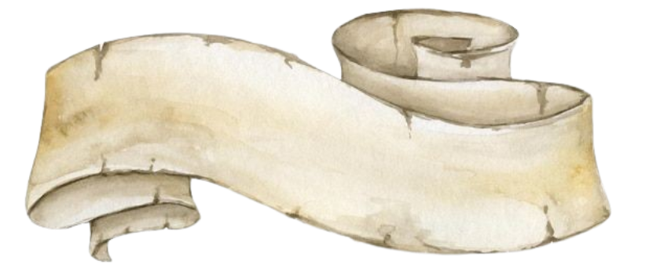

	
    

	

	

 
 

	

<h3>

Meu nome é Maria Eduarda, tenho 16 anos e atualmente estudo Desenvolvimento de Sistemas.

Meu foco está especialmente nas áreas de UI e UX Design, buscando aprimorar meus conhecimentos em criação de interfaces, experiência visual, desenvolvimento de sites e satisfação do usuário com o produto final. Tenho como objetivo continuar me desenvolvendo profissionalmente, construindo projetos que unam criatividade e tecnologia e transformando minhas ideias em soluções visuais e funcionais, alinhadas aos meus objetivos acadêmicos e profissionais.

Além da tecnologia, também gosto de desenho e música, atividades que contribuem para o desenvolvimento da minha criatividade e ampliam minha maneira de enxergar diferentes possibilidades. Acredito que essas experiências me permitem explorar novas ideias, experimentar abordagens diferentes e criar projetos que fujam do convencional. </h3>